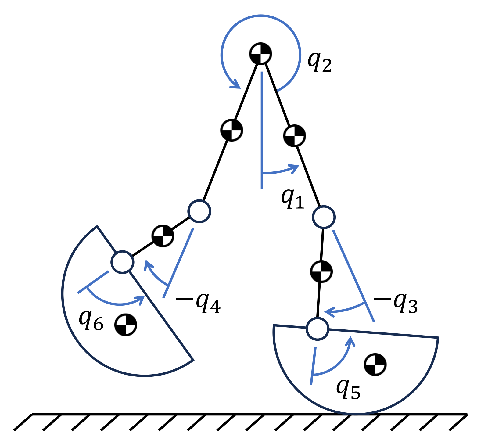

# Robotics Simulation · Controls · Mechanical Engineering

I am a mechanical engineer with a Ph.D. background in predictive simulation, optimization, and robotic control. My work spans physics-based modeling, control systems, MATLAB/Simulink, Python, and robotics—connecting computational methods with engineering systems and experimental results.

<a class="btn btn-primary" href="resume.pdf">Download Resume</a>
<a class="btn btn-outline-primary" href="https://github.com/yaplenicholas">GitHub</a>
<a class="btn btn-outline-primary" href="mailto:yaplenicholas@gmail.com">Contact</a>

## Selected projects

::: {.project-card .project-card-featured}
::: {.columns}
::: {.column width="68%"}
[Ph.D. Dissertation · Penn State · 2026]{.finding-label}

### Predictive Walking Simulation & Control
Built a 2D lower-body skeletal walking model with hybrid-zero-dynamics control and gait optimization. I used it to test whether unilateral weakness, slower torque development, or altered walking objectives could explain post-stroke gait changes.

**Focus:** Dynamics and physics modeling · MATLAB · Optimization · Robotic control

[Research details →](research.qmd) · [Dissertation (PDF)](research/dissertation/Yaple_Dissertation_2026.pdf)
:::
::: {.column width="4%"}
:::
::: {.column width="28%"}
{fig-alt="Six-link planar biped model diagram" .card-thumb}
:::
:::
:::

::: {.project-card}
### Robotic Arm Teleoperation
Developing a camera-based teleoperation system mapping human arm position to a robotic arm, integrating Python computer vision, pose detection, ROS 2, and robot control.

**Focus:** Robotics integration · Python · Computer vision · ROS 2

[Project details →](projects.qmd)
:::

::: {.project-card}
### Disc Flight Simulation & Instrumentation
Building disc-flight simulations and an instrumented data-collection device using IMUs, with experimentally collected data used to validate simulation behavior.

**Focus:** Physics simulation · Python · Instrumentation · Experimental validation

[Project details →](projects.qmd)
:::

## Current engineering work

**Control Engineer II (Contract) — Wabtec**  
*October 2026–Present*

Converting legacy control software into optimized MATLAB/Simulink implementations, and validating the converted controllers from simulation to real-world operation (sim-to-real).

## Technical areas
- **Simulation & modeling:** predictive simulation, physics modeling, trajectory optimization, gait simulation
- **Controls:** robotic control, hybrid zero dynamics, control-system conversion and testing
- **Software:** MATLAB, Simulink, Python
- **Robotics & integration:** ROS 2, computer vision, microcontrollers, mechatronics
- **Engineering:** biomechanics, solid mechanics, instrumentation, experimental analysis

## About
My interests center on simulation and control of dynamic systems, robotics, modeling, optimization, and translating engineering concepts into working implementations. I enjoy problems that connect software, physics, hardware, and measurable system performance.
