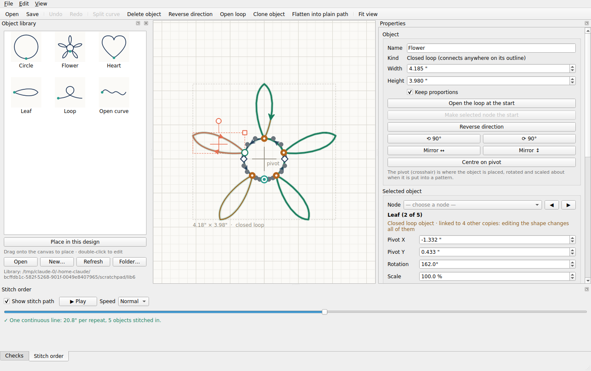
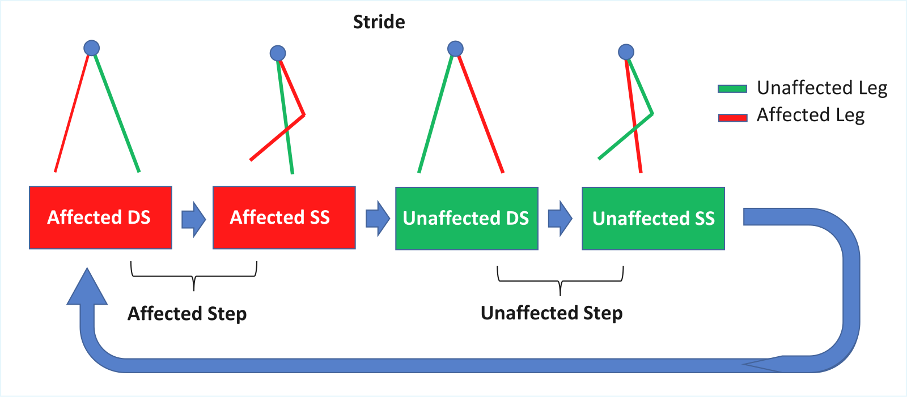

# Selected engineering projects

## Robotic Arm Teleoperation with Vision
**2025–Present**

Designed a modified control approach for an existing robotic arm using human arm positions captured from a single camera. The system integrates Python, OpenCV, MediaPipe pose detection, ROS 2, and machine-learning components.

- Captures and interprets human arm position using camera-based perception.
- Connects perception outputs with robotic control through ROS 2.
- Explores practical integration of sensing, software, and robot motion.

**Technologies:** Python · OpenCV · MediaPipe · ROS 2 · Machine learning

<!-- TODO: add a system diagram, video, GIF, or demonstration image -->

---

## Neural-Network Control of Inverted Pendulums
**Ongoing**

Experimenting with learned controllers for underactuated systems in MATLAB, starting from a cart-pole (block and inverted pendulum) and extending to a double inverted pendulum on a cart.

- Derived the cart-pole and cart–double-pendulum dynamics and built baseline controllers: open-loop, PD, and LQR from the linearized upright model.
- Implemented a flexible multilayer-perceptron controller whose weights are trained with gradient-free optimizers: particle swarm, CMA-ES, and a reward-driven evolutionary strategy (neuroevolution).
- Trained a swing-up network that hands off to an LQR catch controller at the top, and a dual-network (swing-up + stabilization) controller for the double pendulum.
- **Next:** rebuilding the systems in MuJoCo to train and test the same controllers in a full physics engine.

**Technologies:** MATLAB · LQR · Neural networks · CMA-ES · Particle swarm optimization · Underactuated control

---

## Disc Flight Simulation & Instrumented Data Collection
**2024–Present**

Developed disc-flight simulations in Python and worked on an in-development instrumented disc using IMUs to collect real-world throw statistics.

- Developed simulation code for disc-flight behavior.
- Designed an instrumented data-collection approach using IMUs.
- Use experimentally collected data to validate and improve simulation.

**Technologies:** Python · Physics modeling · IMUs · Experimental validation

<!-- TODO: add simulation plots, device photos, and sim-vs-measured comparison -->

---

## Quilt Studio: Longarm Pantograph Design App
**Ongoing · personal project**

A desktop app for designing edge-to-edge (pantograph) patterns for longarm quilting machines, where the whole design has to be stitched as one continuous line. Built in Python using an AI-assisted development workflow.

{fig-alt="Quilt Studio object editor window showing a flower motif made of five leaf loops, an object library panel, a properties panel, and a stitch order slider."}

- **Pattern and motif editors** built on chains of cubic Bézier curves, with seamless left-to-right repeats, a library of reusable motifs (hearts, leaves, loops), and live design checks for crossings, sharp points, and seam drift.
- **Picture and SVG import:** traces drawings into curves, then routes a single continuous stitch path through every line with the fewest and shortest doubled-back passes (graph-based routing).
- **AI-assisted motif editing:** an AI chat reviews a motif with numbered nodes and replies with small, checkable edits that the app applies, rather than redrawing the shape.
- About 57,000 lines of Python (PySide6, NumPy, SciPy, Shapely, NetworkX, scikit-image) with 780+ automated tests.

**Technologies:** Python · PySide6 · Computational geometry · Graph algorithms · AI-assisted workflows

*Source code is private.*

---

## Predictive Walking Simulation & Control
**Ph.D. Research**

Developed capabilities for a 2D lower-body skeletal model in MATLAB using hybrid zero-dynamics (HZD)-based control to perform two-step periodic predictive walking simulations.

{fig-alt="Stride diagram with affected and unaffected double- and single-support phases."}

- Improved simulation capabilities for foot-ground interaction, impacts, walking mechanics, and optimization. The new routine found baseline gaits with more than 20% lower energetic cost.
- Investigated gait changes associated with unilateral torque capability limitations and torque-rate limits.
- Studied walking objectives and mechanics associated with asymmetry, step length, and double-support time.

**Technologies:** MATLAB · Predictive simulation · Optimization · HZD-based control · Biomechanics

[Research details →](research.qmd) · [Dissertation (PDF)](research/dissertation/Yaple_Dissertation_2026.pdf) · [Simulation code](research.qmd#code-and-reproducibility)
