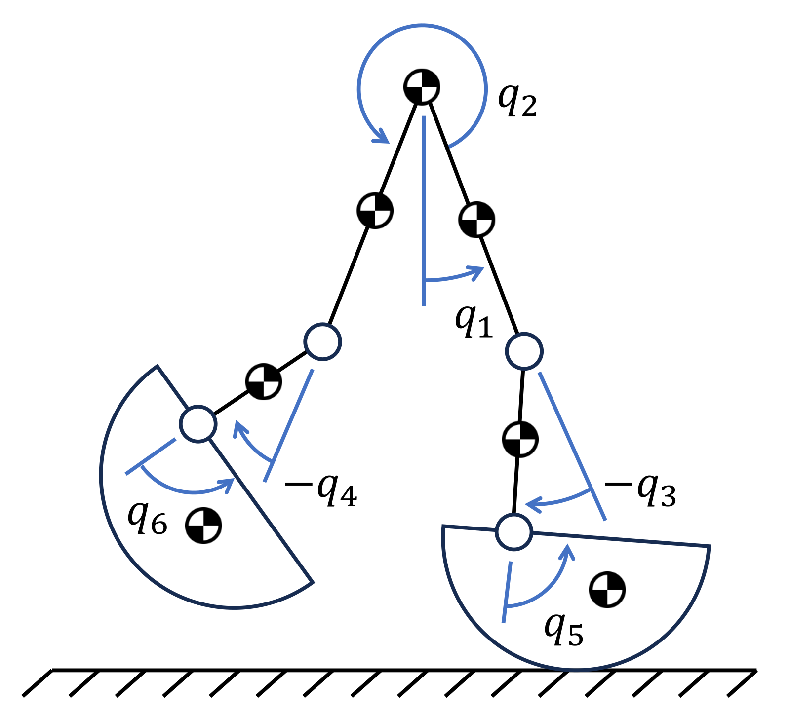
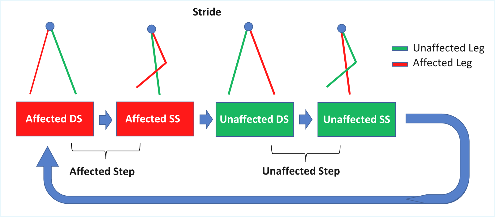
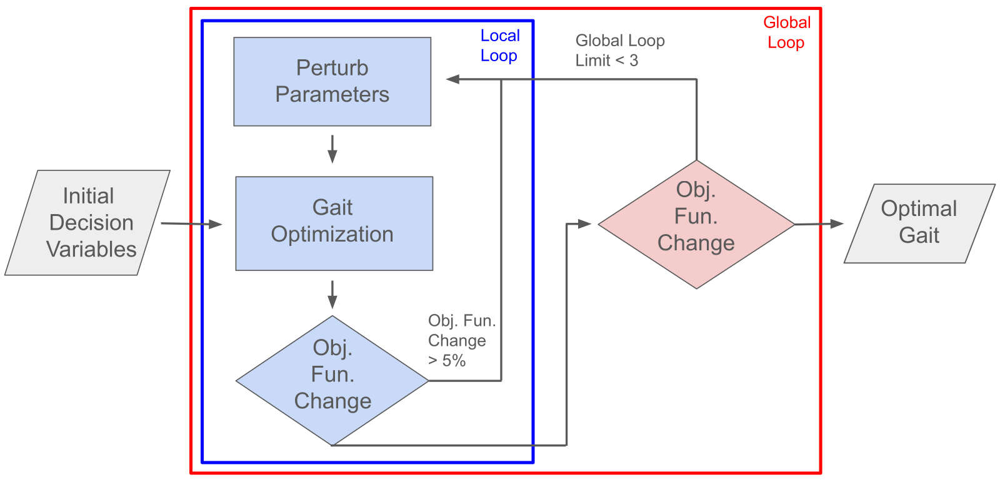
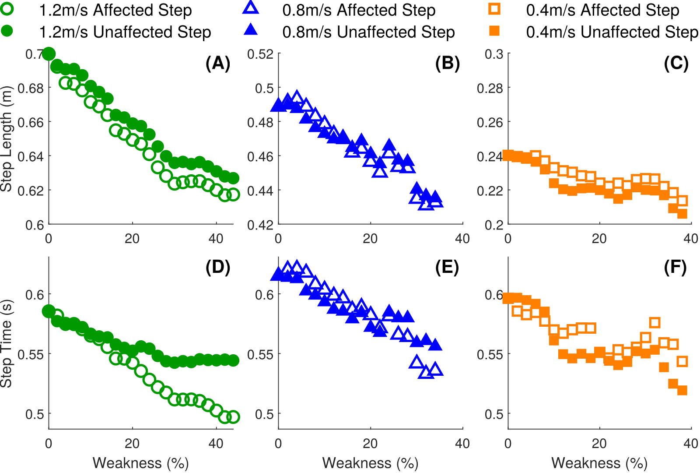
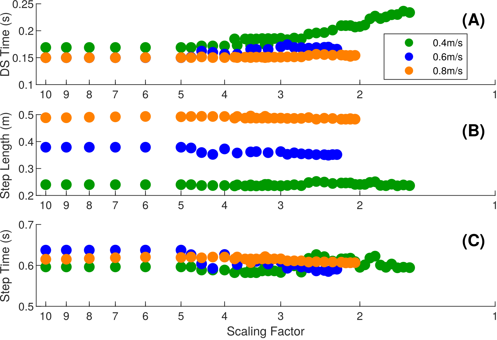
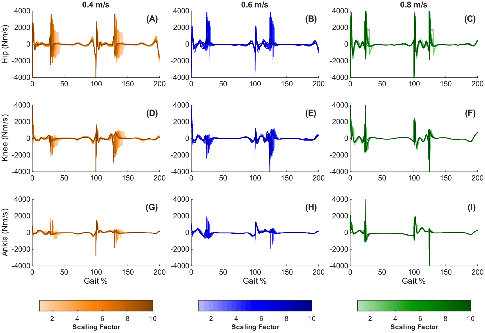
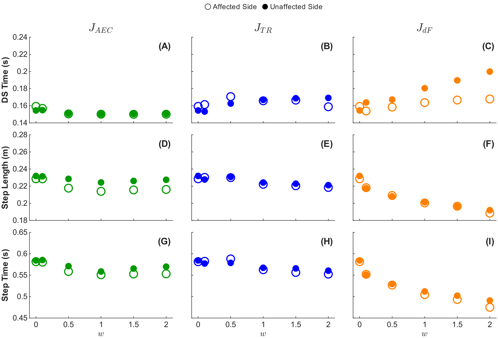
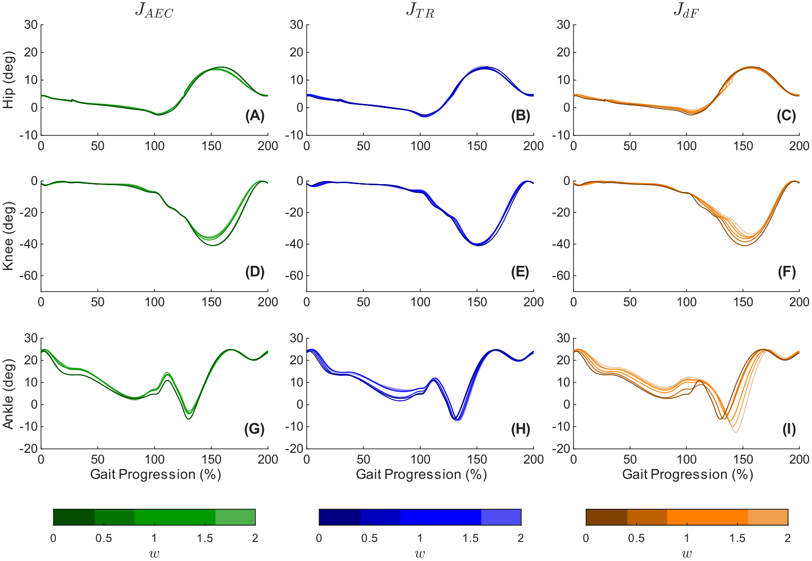
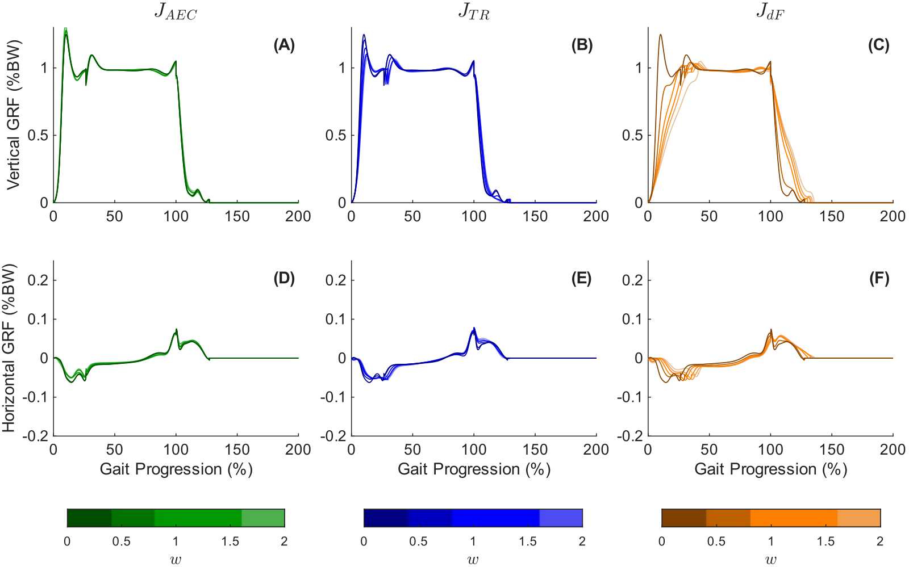

::: {.research-meta}
**Nicholas Yaple** · Ph.D., Mechanical Engineering · The Pennsylvania State University · August 2026
Advisor: Anne E. Martin, Ph.D. · Gait Optimization (GO) Lab
:::

<div class="hero-buttons">
<a class="btn btn-primary" href="research/dissertation/Yaple_Dissertation_2026.pdf"><i class="bi bi-file-earmark-pdf"></i> Read the dissertation (PDF)</a>
<a class="btn btn-outline-primary" href="#code-and-reproducibility"><i class="bi bi-code-slash"></i> MATLAB code</a>
<a class="btn btn-outline-primary" href="#cite-this-work"><i class="bi bi-quote"></i> Cite</a>
</div>

## Overview

People with post-stroke hemiparesis typically walk more slowly, more asymmetrically, and at a higher metabolic cost than people without a stroke. It is not well understood whether these changes come from **physical impairments** (such as weakness) or from **changes in what a person is trying to optimize** while walking. Both are difficult to isolate in experiments, and falls are a real risk for this population. Predictive simulation makes it possible to test each factor on its own.

I developed a 2D lower-body skeletal model that can walk asymmetrically, controlled with hybrid-zero-dynamics (HZD)-based control and driven by gait optimization. I then used it to answer three questions:

::: {.findings-grid}
::: {.finding-card}
[Chapter 2]{.finding-label}

#### Unilateral weakness

Does limiting joint torque on one side create step asymmetry?

**Mostly no.** Asymmetry stayed small: the largest was 10% step-time asymmetry, compared with 40–80% reported clinically. Instead, step length and time shortened by about 10–15% on both sides, and energetic cost rose.
:::

::: {.finding-card}
[Chapter 3]{.finding-label}

#### Torque-rate limits

Does a slower rate of torque development lengthen double support?

**Yes, especially when walking slowly.** Lower torque-rate limits increased double-support time, most at 0.4 m/s, and raised energetic cost. Step length and time stayed nearly unchanged.
:::

::: {.finding-card}
[Chapter 4]{.finding-label}

#### Altered walking objectives

Can walking goals other than energy explain post-stroke features?

**Partly.** Adding asymmetric effort, torque-rate, or GRF-rate terms shortened steps. The GRF-derivative term also reduced peak knee flexion and smoothed and lowered GRFs, which are features of post-stroke gait.
:::
:::

**The common thread:** in all three studies, near-symmetric gait remained optimal. No single impairment or objective reproduced clinical-scale asymmetry. This suggests that the large asymmetries seen after stroke likely come from several factors combining. A consistent shift toward shorter, quicker steps supports the slower preferred walking speeds observed after stroke.

## Abstract

::: {.callout-note collapse="true" appearance="simple" icon=false}
## Read the full abstract

People post-stroke often have chronic impairments such as hemiparesis, defined as weakness or reduced mobility in one half of the body. Consequently, they walk with slower preferred speeds, asymmetric gait, and increased metabolic cost. However, the underlying factors causing the asymmetry are not well understood. It is unclear whether the gait changes are driven by physical impairments or non-physical attributes, such as changing walking objectives. Usually, people walk in a way that is energetically efficient. However, energetic cost alone does not explain gait preferences post-stroke. Since it is difficult to perform physical experimental studies to quantify impairments and walking objectives, predictive simulations are advantageous for investigating how people self-select their gait post-stroke. However, few predictive simulations have been utilized to investigate these gait adaptations; of those that have, the primary focus has remained on muscle weakness.

Using a 2D predictive walking model, this work investigated how spatiotemporal asymmetry develops with joint-level unilateral weakness. During gait optimization, the joint torques were clipped to a percentage of the baseline gait (without weakness). The findings indicated that step asymmetries were small, but step length and time decreased bilaterally. However, the double support (DS) time in simulations remained very low and torque rates were high. Therefore, this work then investigated the rate of torque development (RTD), which may also contribute to spatiotemporal disturbances post-stroke, such as increased time spent in DS. Torque rate limits were applied during gait optimization, clipping the model's torque rates and reduced until optimization failure. The results suggest that decreased torque rates increase DS times, particularly at lower speeds.

To investigate gait changes as result of potential objective function changes and compare to the results of torque and torque rate limitations, we introduced three additional objective function terms in addition to energetic cost (EC): asymmetric EC ($J_{AEC}$) for its effects on increasing step asymmetries, torque rate ($J_{TR}$) for its effects on increasing DS time, and ground reaction force (GRF) derivative ($J_{dF}$) for its effects on step asymmetries and GRF reductions. Optimal gaits reveal asymmetry for all terms were small, step lengths and times decreased, and $J_{AEC}$ and $J_{dF}$ terms reduced peak knee flexion.

Overall, using torque capability limitations, we investigated how directly restricting torques changes gait; using additional objective function terms, we investigated how a preference for reduced torque and GRF reductions changes gait. These findings indicated that near symmetry is typically optimal and torque capability limits yielded similar results as their objective function equivalents. The tendency toward decreased step length and time may support slower preferred walking speeds post-stroke and may support including $J_{dF}$ in healthy walking to improve GRF interactions.
:::

## The model and simulation framework

Existing HZD skeletal walking models had point feet, treated double support as instantaneous, or assumed one-step symmetric gait. None of these assumptions holds for post-stroke walking, where double support can exceed 50% of the gait cycle. I merged two earlier models from our lab and extended them into a framework that can walk asymmetrically with finite double support.

::: {.columns}
::: {.column width="45%"}
{#fig-biped fig-alt="Diagram of six-link planar biped with labeled joint angles q1 through q6 and curved feet on hatched ground."}
:::

::: {.column width="5%"}
:::

::: {.column width="50%"}
**Model**

- Six-link sagittal-plane lower body (hip, two thighs, shanks, and curved feet)
- Scaled to an average adult: 0.9 m leg length, 87 kg
- HZD-based control: joints track Bézier-polynomial trajectories within each phase

**Key extensions I developed**

- **Two-step periodic gait.** The stride is split into four phases (affected DS → affected SS → unaffected DS → unaffected SS), which allows left-right asymmetry.
- **Finite double support**, with C² (position, velocity, and acceleration) continuity enforced across every phase transition.
- **Compliant ground contact** using nonlinear spring-dampers with a bristle-style friction formulation. This removed unrealistic GRF spikes and micro-oscillations at contact.
- **Adjustable inter-foot distance in DS**, so the model better accommodates ground compliance.
- **A robust gait optimization routine** with local and global perturbation loops. It found baseline gaits with **more than 20% lower energetic cost** than previously generated gaits.
:::
:::

{#fig-phases fig-alt="Stride diagram showing four phases: Affected DS, Affected SS, Unaffected DS, Unaffected SS, looping back."}

{#fig-opt fig-alt="Flow chart: initial decision variables, then gait optimization inside local and global perturbation loops, then optimal gait."}

**Tools:** MATLAB · direct-shooting gait optimization (constrained nonlinear programming) · hybrid dynamical systems · Bézier-parameterized virtual constraints

---

## Chapter 2: Unilateral weakness and spatiotemporal asymmetry

**Question.** Does joint-level weakness on one side of the body cause step-length and step-time asymmetry?

**Approach.** Hip, knee, and ankle torques on the affected side were clipped to a decreasing percentage of their baseline (healthy-gait) maximum. The gait was re-optimized for minimum energetic cost at each weakness level, at 1.2, 0.8, and 0.4 m/s, until optimization failed. The maximum weakness reached was 42% at 1.2 m/s, 32% at 0.8 m/s, and 38% at 0.4 m/s.

{#fig-ch2 fig-alt="Six scatter plots of step length and step time versus weakness percent at three speeds, both decreasing with weakness."}

**Findings**

- Step asymmetry stayed below 5% in nearly all cases. The maximum was **10% step-time asymmetry** at 1.2 m/s, far below the 40–80% observed experimentally and the ~30% reported in muscle-driven simulations.
- The dominant adaptation was **bilateral shortening of steps (≈10–15%)**, which is consistent with the shorter strides seen after stroke.
- Energetic cost rose with weakness: up to ~20% at 1.2 and 0.4 m/s, and ~60% at 0.8 m/s.
- Asymmetry *direction* depended on speed (positive at faster speeds, negative at 0.4 m/s). This points to a shallow energetic landscape where several gait strategies cost nearly the same.

**Implication.** Strength training alone may be insufficient to restore symmetric gait. Weakness is only one part of the post-stroke picture.

---

## Chapter 3: Reduced rate of torque development and double-support time

**Question.** In Chapter 2, double support stayed at its 0.15 s lower bound, and torque rates spiked near phase transitions. Does limiting the *rate* of torque development lengthen double support, as seen after stroke?

**Approach.** Joint torque rates were clipped bilaterally to a scaling factor of the baseline rates. The factor was reduced step by step at 0.4, 0.6, and 0.8 m/s until optimization failed. The lowest feasible scaling factors were 1.55, 2.20, and 2.05×.

{#fig-ch3 fig-alt="Three stacked scatter plots versus torque-rate scaling factor; DS time increases at 0.4 m/s while step length and time are flat."}

**Findings**

- **Double-support time increased as torque-rate limits decreased**, most strongly at 0.4 m/s. At every speed, DS time moved off its lower bound.
- Step length and step time stayed largely the same. The extra DS time came from spreading torque development over a longer window around phase transitions.
- Energetic cost increased significantly once the scaling factor fell below ~3–5×. This suggests the unconstrained model had been exploiting non-physiological, transient torque spikes.
- Lower torque-rate limits were reachable at slow speeds. This hints that reduced rate of torque development (RTD) may contribute to choosing slower walking speeds.

**Implication.** RTD, not just peak strength, may be a meaningful rehabilitation target, and realistic torque-rate limits may matter for predictive gait models in general.

{#fig-ch3b fig-alt="Grid of torque-rate trajectories for hip, knee, ankle at three walking speeds with saturation at the limits." .figure-secondary}

---

## Chapter 4: Altered walking objectives

**Question.** Energetic cost alone does not explain post-stroke gait preferences. Could a change in *what is being minimized* produce post-stroke gait features, and how does that compare with the hard physical limits from Chapters 2 and 3?

**Approach.** Three candidate terms were added to the energetic-cost objective, each scaled and swept in weight $w$ at 0.4 and 0.8 m/s:

| Term | Represents | Counterpart |
|---|---|---|
| $J_{AEC}$: asymmetric energetic cost | Higher perceived effort on the affected side | Unilateral weakness (Ch. 2) |
| $J_{TR}$: torque-rate squared | Preference for slower torque development | Torque-rate limits (Ch. 3) |
| $J_{dF}$: GRF-derivative | Preference for gentler ground loading | (no physical counterpart) |

: {.table-sm}

A regression analysis of combined objectives examined interaction effects between the terms.

{#fig-ch4 fig-alt="Nine scatter plots: DS time, step length, step time versus objective weight for three objective terms at 0.4 m/s."}

**Findings**

- All three terms **shortened step length and step time**. $J_{dF}$ had the largest effect and was the strongest predictor in the combined-objective regression.
- $J_{AEC}$ and $J_{TR}$ behaved much like their physical-limit counterparts. Torque-rate *limits* were more effective at lengthening DS than the torque-rate *objective*.
- $J_{AEC}$ and especially $J_{dF}$ **reduced peak knee flexion**, a possible mechanism for stiff-knee gait. $J_{dF}$ also produced **lower, more gradual GRFs** that resemble post-stroke kinetics.
- Asymmetry remained small for every term, even when the objective itself was asymmetric.
- Interaction terms opposed the linear terms, which damped the overall step changes.

**Implication.** Altered walking objectives changed joint kinematics and GRFs more than torque limits alone did. Clinical assessment may need ways to measure a patient's *walking goals*, not just their physical capacity. The GRF-derivative term may also improve foot-ground interaction in predictive models of healthy gait.

::: {.columns}
::: {.column width="50%"}
{fig-alt="Grid of hip, knee, ankle joint angle trajectories under three objective terms."}
:::
::: {.column width="50%"}
{fig-alt="Grid of vertical and horizontal GRF trajectories under three objective terms."}
:::
:::

---

## Conclusions and future work

- **Near symmetry is usually optimal.** Clinical-scale asymmetry likely comes from several impairments and objective changes acting together, not any single factor.
- **Shorter, quicker steps** emerged across nearly every condition, consistent with slower preferred walking speeds after stroke.
- **Torque-rate limits** are a likely contributor to prolonged double support.
- **Walking objectives** are a plausible driver of kinematic and kinetic changes such as reduced knee flexion and lower GRFs.

**Next steps** include: a unified controller with torque-rate continuity across phases; direct collocation for faster optimization; multivariate and personalized impairment models; stability and balance metrics inside the objective; 3D dynamics; and eventually machine-learning methods to identify the combination of impairments and objectives that best reproduces an individual's gait.

## Code and reproducibility {#code-and-reproducibility}

The simulation and optimization framework used throughout the dissertation is written in **MATLAB** and collected as **DSR (Double Support Radius)**.

::: {.project-card}
#### DSR: 2D predictive walking simulation (MATLAB)

Six-link HZD-controlled biped with finite double support, compliant ground contact, two-step periodic asymmetric gaits, torque and torque-rate limits, configurable objective terms ($J_{EC}$, $J_{AEC}$, $J_{TR}$, $J_{dF}$), and the perturbation-based gait optimization routine.

**Language:** MATLAB (Optimization Toolbox)

<a class="btn btn-sm btn-outline-primary" href="https://github.com/yaplenicholas/DSR"><i class="bi bi-github"></i> View repository</a>
:::

## Publications and presentations

- **N. Yaple.** *Using 2D Predictive Walking Simulations to Investigate Post-stroke Gait Changes with Reduced Torque Capabilities.* Ph.D. Dissertation, Mechanical Engineering, The Pennsylvania State University, 2026. [[PDF]](research/dissertation/Yaple_Dissertation_2026.pdf)
- **N. L. Yaple, A. E. Martin.** *Changes in Spatiotemporal Asymmetry Due to Weakness and Spasticity in Predictive Walking Simulations.* American Society of Biomechanics (ASB) Annual Meeting, 2024. [[Abstract]](research/dissertation/Yaple_ASB2024_Abstract.pdf)

## Cite this work {#cite-this-work}

```bibtex
@phdthesis{yaple2026predictive,
  author = {Yaple, Nicholas},
  title  = {Using 2D Predictive Walking Simulations to Investigate
            Post-stroke Gait Changes with Reduced Torque Capabilities},
  school = {The Pennsylvania State University},
  year   = {2026},
  month  = {August},
  type   = {Ph.D. Dissertation},
  note   = {Department of Mechanical Engineering}
}
```

## Acknowledgments

**Committee:** Anne E. Martin (Advisor and Chair), Jean-Michel Mongeau, Katie Fitzsimons, Joseph Cusumano, and Bryant Seamon (Special Member).

This material is based upon work supported by the National Science Foundation under Award No. 1943561. Any opinions, findings, and conclusions or recommendations expressed are those of the author and do not necessarily reflect the views of the NSF.
